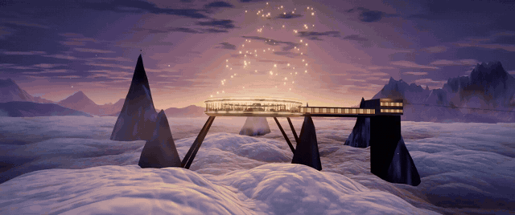
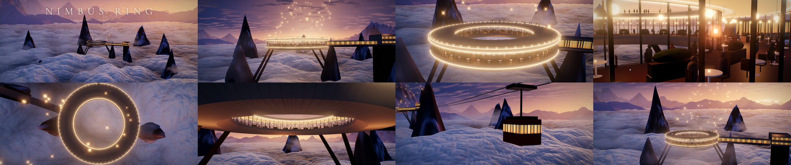

<div align="center">

<a href="https://jeiel85.github.io/nimbus-ring/media/nimbus-ring.mp4"></a>

# NIMBUS RING

**구름바다 위에 떠 있는 콘크리트 링 레스토랑 — 실시간 Three.js 월드와, 그 안을 드론처럼 날며 렌더링한 45초 시네마틱 필름**

<sub>A concrete halo restaurant above a sea of clouds · real-time Three.js world + a 45 s drone film rendered from it</sub>

<br>

[](https://jeiel85.github.io/nimbus-ring/)
[](https://jeiel85.github.io/nimbus-ring/media/nimbus-ring.mp4)


</div>

---

## 한 줄 프롬프트에서 시작했습니다

> yo claude make a cinematic 3d render video in that world. some shots should be pretty wide some close up and overall make it pretty creative. fly around like with a drone and render that video. ~45s is enough

Threads에서 본 [@aicoffeechat의 글](https://www.threads.com/@aicoffeechat/post/DfQfKibClQN)(“three.js로 Opus 5.5가 만든 세상”)의 프롬프트를 그대로 받아, **구름바다 위 링 레스토랑**이라는 콘셉트만 참고해 장면·셰이더·카메라·사운드를 전부 새로 만들었습니다. 외부 3D 모델이나 텍스처, 음원 파일은 하나도 쓰지 않았고 모든 것이 코드로 생성됩니다.

## 샷 리스트



| # | 샷 | 시간 | 카메라 |
|---|----|------|--------|
| 01 | **ESTABLISHING** | 0:00 | 망원 30mm 느낌의 초광각 설정샷. 노을 띠 앞에 작은 헤일로, 타이틀 |
| 02 | **CLOUD SKIM** | 0:06 | 구름 꼭대기 4 m 위를 시속 118 km로 스치는 FPV, 뱅크 후 링을 향해 상승 |
| 03 | **THE HALO** | 0:12 | 링 주위를 반 바퀴 도는 오빗 |
| 04 | **DINING ROOM** | 0:17 | 유리 파사드를 따라 미끄러지는 클로즈업 돌리 — 촛불, 펜던트, 손님 |
| 05 | **HALO DROP** | 0:23 | 정수리 위 탑다운에서 회전하며 링 구멍을 통과해 구름 속으로 낙하 → 화이트아웃 |
| 06 | **UNDERSIDE** | 0:28 | 화이트아웃이 걷히며 링 아래에서 올려다보는 로우 앵글 |
| 07 | **LAST CABIN** | 0:33 | 구름 위를 건너오는 케이블카와 나란히 비행 |
| 08 | **FAREWELL** | 0:38 | 테라스에서 풍등과 함께 시작해 하늘로 빠지는 롱 풀백, 엔드 카드 |

## 월드에 들어 있는 것

- **구름바다** — 정점 셰이더에서 billow 노이즈로 변위하고, 프래그먼트에서 7옥타브 높이장의 법선을 다시 계산하는 9 km 메시. 노을 쪽 역광 실버 라이닝, 계곡 AO, 레스토랑 불빛의 따뜻한 반사, 하늘색으로 녹아드는 원거리 안개
- **블루 아워 하늘** — 해가 막 진 지평선의 불씨 띠, 고층운, 반짝이는 별
- **헤일로** — 지름 58 m 링: 콘크리트 슬래브(보드폼 텍스처), 이중 유리벽과 멀리언, 82개 테이블·의자·손님·촛불·펜던트, 중앙 화단, 루프 테라스와 볼라드, LED 라인, 두 암봉으로 내려가는 4개의 다리
- **절벽 역사·브리지·케이블카** — 1.3 km 현수선 케이블을 따라 오가는 곤돌라
- **풍등** — 테라스에서 끊임없이 떠올라 노을 쪽으로 흘러가는 90개의 등
- **눈송이, 안개 조각, 항공 장애등** — 전부 시간의 순수 함수라 매 프레임이 결정론적
- **필름 그레이드** — 블룸 → ACES 톤매핑 → 스플릿 토닝·색수차·비네트·그레인·2.39:1 레터박스
- **사운드트랙** — 패드 화음 진행, 고공 바람, 종소리, 리버브를 Node에서 직접 합성 (`scripts/soundtrack.mjs`)

## 라이브 데모

**<https://jeiel85.github.io/nimbus-ring/>**

- **FILM** — 렌더 영상과 같은 카메라 시퀀스를 실시간으로 재생. 아래 타임라인의 샷을 누르면 그 샷으로 이동, `Space`로 일시정지
- **EXPLORE** — 드래그로 궤도, 스크롤/핀치로 줌, 우클릭 드래그로 팬
- **▶ RENDER** — 오프라인으로 렌더한 1080p 필름 재생
- `?q=low` / `?q=high`로 품질 강제 (모바일은 자동으로 low)

## 직접 렌더하기

```bash
npm install
```

```bash
npm run serve
```

`http://localhost:5180`에서 실시간 월드를 볼 수 있습니다.

```bash
npm run render
```

헤드리스 Chrome으로 페이지를 띄워 필름 시계를 1/30초씩 옮기며 캡처하고, ffmpeg로 인코딩한 뒤 사운드트랙을 합쳐 `media/nimbus-ring.mp4`를 만듭니다. Chrome과 ffmpeg가 필요하며, Chrome 경로가 다르면 `CHROME_PATH`로 지정합니다. Radeon 780M 내장 GPU에서 1350프레임이 약 9분 걸렸습니다.

```bash
npm run stills
```

샷마다 스틸 한 장씩 `out/stills/`에 저장합니다. 옵션: `--fps 24`, `--width 1280 --height 720`, `--out out/draft.mp4`, `--stills 3,9.5,20`.

## 구조

```
index.html            페이지, 오버레이(타이틀·캡션), 컨트롤 UI
src/main.js           렌더러, FILM / EXPLORE / 캡처 모드
src/world.js          하늘·구름·암봉·헤일로·케이블카·풍등·눈·안개
src/terrain.js        암봉과 원경 산맥 높이 함수
src/shaders.js        GLSL (하늘, 구름, 안개, 눈, 필름 그레이드)
src/shots.js          8개 샷의 카메라 경로·렌즈·흔들림·전환
src/post.js           블룸 → 톤매핑 → 그레이드 컴포저
scripts/render.mjs    프레임 캡처 → ffmpeg → 오디오 먹싱
scripts/soundtrack.mjs  절차적 사운드트랙(WAV)
```

## 크레딧

- 콘셉트 출처: [@aicoffeechat Threads 글](https://www.threads.com/@aicoffeechat/post/DfQfKibClQN)과 그 글이 소개한 원작 [Leonxlnx/halo-above-the-clouds](https://github.com/Leonxlnx/halo-above-the-clouds) — 이 저장소의 코드는 원작을 복제하지 않고 새로 작성했습니다
- 2D simplex noise: Ian McEwan, Ashima Arts ([webgl-noise](https://github.com/ashima/webgl-noise), MIT)
- [three.js](https://threejs.org) (MIT)

## 라이선스

[MIT](LICENSE)
